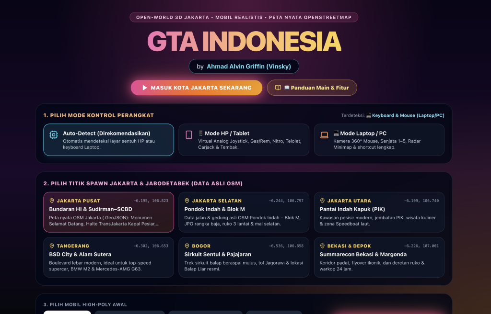
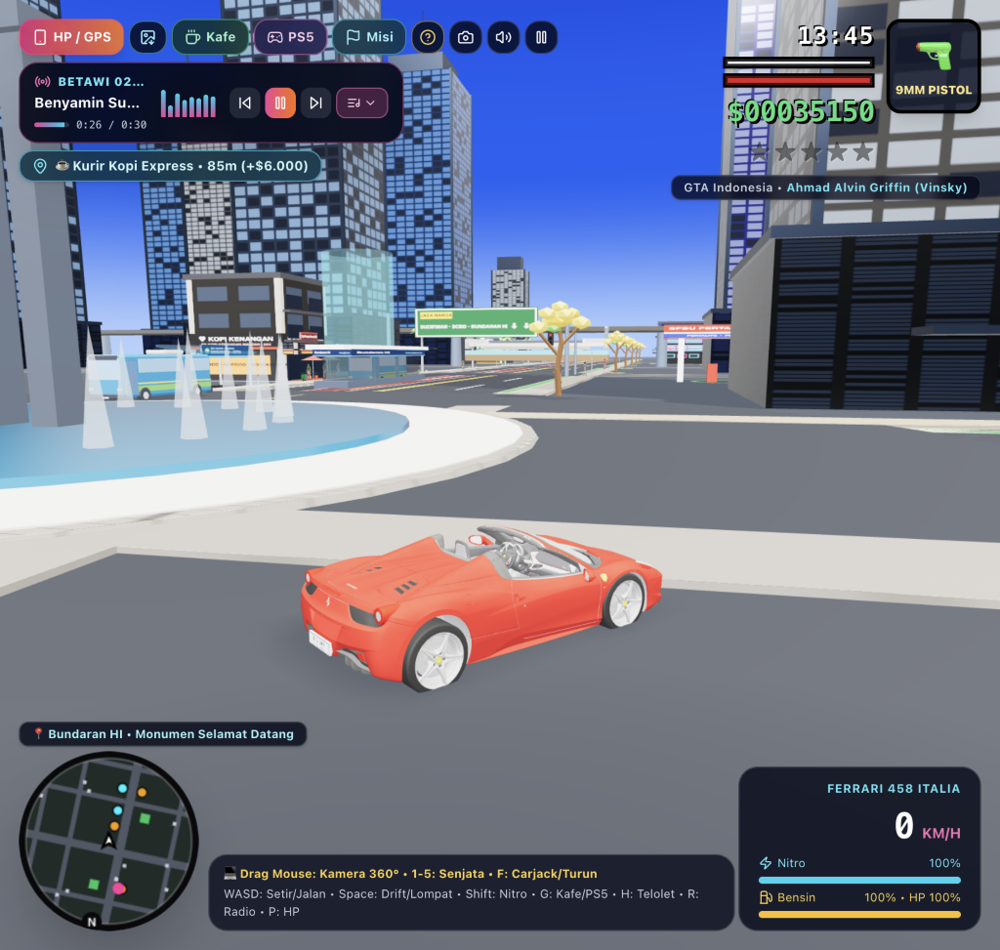
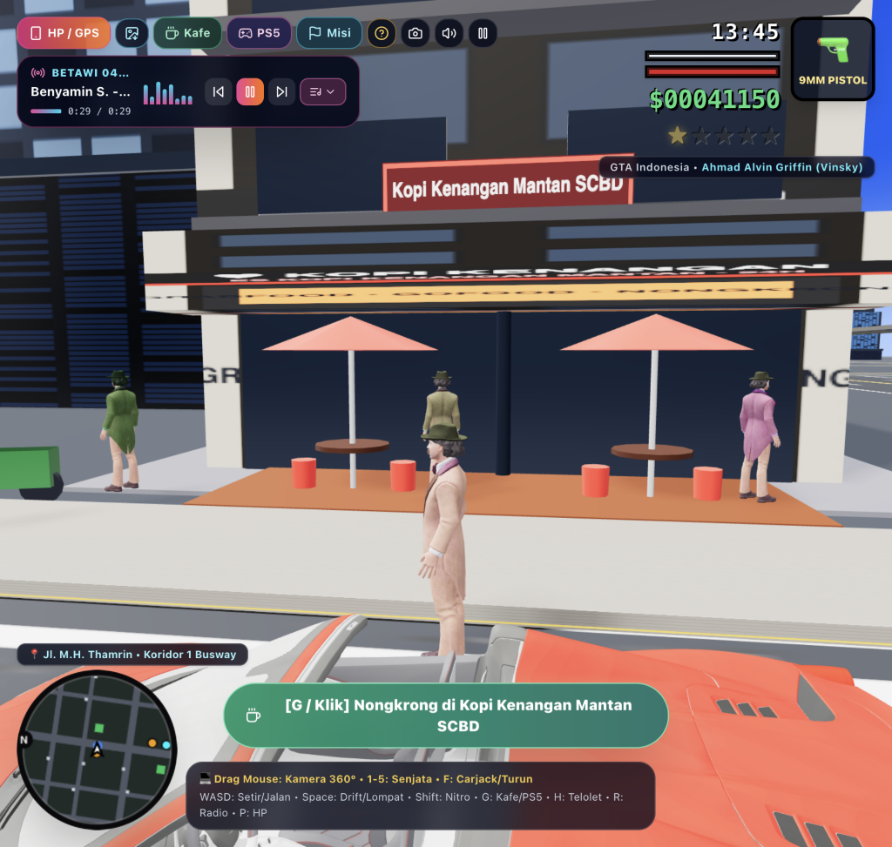
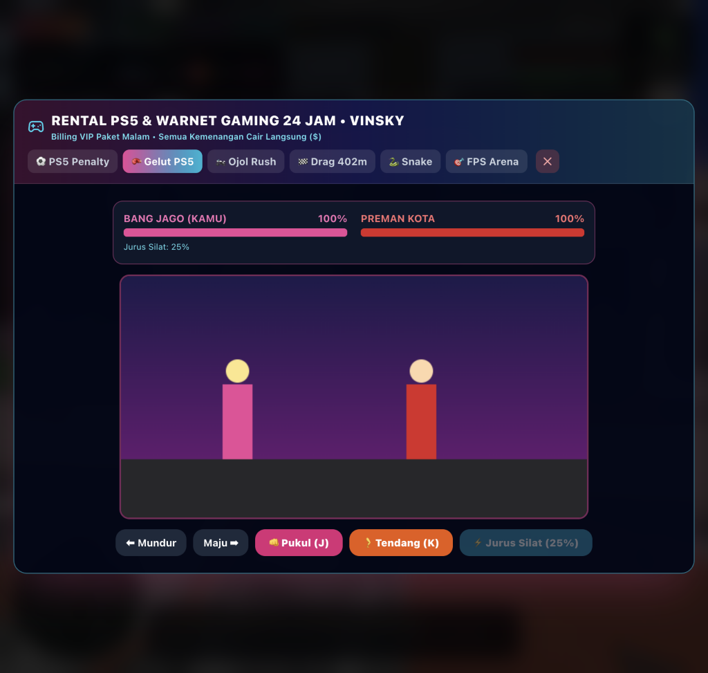

# GTA Indonesia — Open-World 3D Web Game

**GTA Indonesia** adalah game web 3D Open-World bertema Jakarta & Jabodetabek yang dibuat oleh **[Ahmad Alvin Griffin (Vinsky)](https://vinsky-techfolio.vercel.app/)**. Game ini berjalan 100% gratis langsung di browser (mendukung **Laptop/PC Keyboard & Mouse** maupun **HP/Tablet Touchscreen**), menggabungkan atmosfer kota nyata Jakarta dari data OpenStreetMap (`.geojson`), kendaraan 3D high-poly, radio lagu Indonesia & Barat, tempat nongkrong kafe lokal, misi warga Jakarta, dan **Rental PS5 & Warnet Gaming 24 Jam**.

---

## Screenshot Gameplay

### 1. Menu Utama & Pemilihan Perangkat / Wilayah Jabodetabek


### 2. Koridor Bundaran HI – Sudirman, Radio Jukebox, & Sistem Misi Kota Jakarta


### 3. Kafe Nongkrong (Fore Coffee & Kopi Kenangan), Driver Ojol, & NPC Kasual


### 4. Rental PS5 & Warnet Gaming 24 Jam (6 Mini-Games Berhadiah)


---

## Bahasa Pemrograman & Teknologi yang Digunakan

Seluruh sistem pada proyek ini dibangun menggunakan kombinasi beberapa bahasa pemrograman, bahasa shader, dan teknologi web modern:

| Bahasa / Format | Ekstensi File | Fungsi Utama di Proyek | Lokasi File Utama |
| :--- | :--- | :--- | :--- |
| **TypeScript (`5.7.2`)** | `.ts`, `.tsx` | Bahasa inti seluruh aplikasi: engine 3D, fisika kendaraan, auto-scaling kabin model `.glb`, AI lalu lintas & 28 NPC, sistem misi & radar, audio radio jukebox, dan komponen UI Next.js/React. | [`src/components/GTAIndonesiaGame.tsx`](./src/components/GTAIndonesiaGame.tsx), [`src/game/`](./src/game/) |
| **JavaScript / Node.js ES Modules** | `.mjs`, `.js` | Skrip automasi pipeline pengunduhan aset model 3D, pengambil data peta nyata OpenStreetMap Overpass API, generator audio WAV 6-track lokal, serta konfigurasi Next.js & PostCSS. | [`scripts/`](./scripts/), [`next.config.mjs`](./next.config.mjs), [`postcss.config.mjs`](./postcss.config.mjs) |
| **GLSL (OpenGL Shading Language)** | Inline Shader (`.ts`) | Vertex shader dan fragment shader (`THREE.ShaderMaterial`) untuk Atmospheric Sky Dome (gradasi langit pagi, golden-hour sore, hujan, dan malam Jakarta). | [`src/game/CityBuilder.ts`](./src/game/CityBuilder.ts) |
| **HTML5 (`WebGL 2.0`, `Canvas 2D`, `Web Audio API`, `Audio`)** | `.tsx`, `.ts` | Rendering grafis PBR 3D dengan `ACESFilmicToneMapping` + `RoomEnvironment`, generator tekstur prosedural (aspal, busway, rambu Jasa Marga, fasad Fore/Kopi Kenangan/Rental PS5), radar minimap berputar, 6 kanvas mini-games, serta sintesis SFX (mesin, sirine polisi PJR, dan 3 variasi melodi Klakson Telolet Basuri). | [`src/game/IndonesianTextureGenerator.ts`](./src/game/IndonesianTextureGenerator.ts), [`src/game/SoundEngine.ts`](./src/game/SoundEngine.ts), [`src/components/MinigamesModal.tsx`](./src/components/MinigamesModal.tsx) |
| **CSS3 & Tailwind CSS (`3.4.15`)** | `.css`, `.ts` | Tata letak responsif HP (portrait warning + virtual joystick) & desktop, glassmorphism HUD, animasi pulse neon, dan kustomisasi scroll. | [`src/app/globals.css`](./src/app/globals.css), [`tailwind.config.ts`](./tailwind.config.ts) |
| **GeoJSON & JSON** | `.geojson`, `.json` | Data spasial jalan raya dan footprint bangunan nyata koridor Bundaran HI–Sudirman–SCBD dan Pondok Indah–Blok M hasil ekstraksi OpenStreetMap. | [`src/data/jakarta-real-map.geojson`](./src/data/jakarta-real-map.geojson), [`package.json`](./package.json) |
| **WebAssembly (WASM)** | `.wasm` | Decoder kompresi geometri 3D **Google Draco** yang di-host secara lokal agar model kendaraan high-poly dapat didekompresi cepat di browser tanpa ketergantungan CDN luar. | [`public/draco/draco_decoder.wasm`](./public/draco/) |

### Library & Framework Pendukung
- **Next.js `14.2.21` (App Router)** & **React `18.3.1`**
- **Three.js `0.170.0`** (`RoomEnvironment`, `WebGLRenderer`, `ShaderMaterial`, `PMREMGenerator`) + **`three-stdlib` `2.33.0`** (`GLTFLoader`, `DRACOLoader`, `SkeletonUtils`)
- **Lucide React `0.460.0`** untuk ikon antarmuka HUD

---

## Fitur Lengkap Dalam Game

### 1. Kota Jakarta & Jabodetabek Realistis
- **6 Wilayah Spawn Jabodetabek:** Jakarta Pusat (*Bundaran HI – Sudirman – SCBD*), Jakarta Selatan (*Pondok Indah – Blok M*), Jakarta Utara (*Pantai Indah Kapuk + zona Speedboat*), Tangerang (*BSD City – Alam Sutera*), Bogor (*Sirkuit Sentul*), dan Bekasi & Depok (*Summarecon – Margonda*).
- **Landmark & Infrastruktur Khas Jakarta:** Monumen Selamat Datang Bundaran HI, Simpang Susun Semanggi & flyover tol, Halte Busway TransJakarta + jalur khusus Busway, Stasiun MRT Jakarta (*Bundaran HI Astra* & *Dukuh Atas*), JPO Sudirman, Rambu Tol Jasa Marga, SPBU Pertamina (*isi bensin & repair mobil*), serta gedung Wisma 46 Kota BNI, Menara BCA, Plaza Indonesia, & Hotel Indonesia Kempinski.
- **Kafe Nongkrong & Warnet 24 Jam Interaktif:**
  - **Fore Coffee Sudirman**, **Kopi Kenangan Mantan SCBD**, **Warkop & Sate Taichan Senayan**, serta **Rental PS5 & Warnet Vinsky**.
  - Dekati area teras (`[G]` atau klik banner) untuk memesan menu lokal (*Butterscotch Sea Salt Latte Fore*, *Es Kopi Kenangan Mantan*, *Indomie Telor Kornet*, *Sate Taichan*) yang memulihkan HP, Armor, & Nitro 100%, sekaligus membaca obrolan warga/barista.

### 2. Radio & Jukebox Lagu Asli (26+ Pilihan Lagu + Live Search)
- Memutar otomatis playlist lagu Indonesia, lagu Betawi asli, klasik Barat, dan stasiun radio FM Jakarta (*Prambors 102.2 FM*, *Hard Rock 87.6 FM*, *Delta 99.1 FM*, *I-Radio 89.6 FM*) dengan mode **Auto-DJ** (lanjut lagu berikutnya otomatis) atau **Loop 1**.
- Daftar lagu pilihan termasuk **Kahitna – Aku Punya Hati**, **Bryan Adams – Heaven**, **Kincir-Kincir (Lagu Betawi)**, **Benyamin Sueb – Ondel-Ondel**, **Jali-Jali Betawi**, **Benyamin S. – Malam Minggu**, **Sheila On 7 – Dan...**, **Dewa 19 – Kangen**, **Chrisye – Seperti Yang Kau Minta**, **Peterpan – Bintang Di Surga**, **Tulus – Hati-Hati di Jalan**, **Diskoria & Dian Sastro – Serenata Jiwa Lara**, **Hindia – Secukupnya**, **Pamungkas – To the Bone**, **RAN – Pandangan Pertama**, **MALIQ & D'Essentials – Pilihanku**, **Vierra – Seandainya**, **Slank – Ku Tak Bisa**, **GIGI – 11 Januari**, **SAMSONS – Kenangan Terindah**, dan **Yovie & Nuno – Janji Suci**.
- Mendukung **Cari Lagu Live** langsung dari bilah pencarian radio serta **Upload MP3** lokal dari perangkat pengguna, lengkap dengan 6 trek fallback `.wav` lokal offline.

### 3. Kendaraan High-Poly, NPC Hidup, Misi Kota & Polisi PJR
- **Pilihan Kendaraan:** Ferrari 458 Italia, Lamborghini Aventador SV, Mercedes-AMG G63, BMW M2 Coupe G87, Sport EV Coupe SU7, SUV/MPV Keluarga, Taksi Bluebird, Bus TransJakarta, Angkot Mikrolet, Motor Sport & Ojol, Polisi PJR Korlantas, hingga Pesawat & Speedboat.
- **28+ NPC Kasual & Dinamis:** Pejalan kaki yang berhenti di lampu merah, pengunjung teras Fore Coffee & Kopi Kenangan, serta driver Ojol beserta motornya. Bunyikan **Klakson Telolet Basuri (`H`)** (3 variasi melodi Basuri) agar warga bersorak dan memberi tip `+$150`, atau lihat warga berlari menghindar saat kamu mengebut atau menembak senjata (`1–5`, termasuk RPG-7).
- **Sistem Misi Kota Jakarta (`M`):** Jalankan misi *Kurir Kopi Express*, *Penumpang VIP MRT*, dan *Turnamen E-Sports PS5* berhadiah `$6.000`–`$8.500` dengan penunjuk beacon 3D & radar minimap.

### 4. Rental PS5 & Warnet Gaming 24 Jam (6 Mini-Games)
1. **⚽ PS5 Liga Tarkam Penalty** — Adu penalti 5 tendangan lawan kiper AI (`+$3.000/gol` + bonus `$10.000`).
2. **🥊 PS5 Gelut Betawi Fighter** — Tarung arcade *Bang Jago vs Preman Kota* dengan Jurus Silat (`+$15.000` K.O.).
3. **🏍️ Ojol Sudirman Rush** — Antar pesanan *Fore Coffee* & *Kopi Kenangan* melintasi lalu lintas 4 jalur (`+$300/kopi`).
4. **🏁 Sentul Drag Race 402m** — Balap drag manual 6-gigi + NOS berhadiah `$12.000`.
5. **🐍 Neon Cyber Snake** — Ular arcade klasik berhadiah `$40/poin`.
6. **🎯 Urban Warzone FPS** — Arena tembak-tembakan bot 3D (`+$1.500/kill`).

---

## Kontrol Permainan

| Tombol Keyboard (Laptop/PC) | Aksi di Game | Mode HP / Layar Sentuh |
| :--- | :--- | :--- |
| **`W A S D` / Panah** | Menyetir kendaraan / Berjalan kaki | Virtual Analog Joystick + Pedal Gas/Rem |
| **`Drag Mouse`** | Putar kamera 360° di sekitar mobil/karakter | Geser layar / kontrol sentuh |
| **`Space`** | Rem tangan & Drift / Lompat | Tombol **REM / LOMPAT** |
| **`Shift`** | Nitro Boost / Lari Sprint | Tombol **NITRO / LARI** |
| **`F`** | Keluar / Masuk / Carjack mobil di jalan | Tombol **Keluar / Masuk** |
| **`G`** | Masuk Kafe Nongkrong / Rental PS5 terdekat | Klik banner prompt **`[G / Klik]`** atau HUD |
| **`M`** | Mulai / Ganti **Misi Kota Jakarta** | Klik tombol **Misi** di HUD atas |
| **`H`** | Klakson **Telolet Basuri V1/V2/V3** | Tombol **Telolet** |
| **`C`** | Ganti sudut kamera (*Chase / Hood / Cockpit*) | Ikon Kamera di HUD atas |
| **`R`** | Ganti lagu / stasiun Radio Jakarta | Kontrol Radio di kiri atas |
| **`P`** | Buka Smartphone vOS (*GPS, Street View, Garasi Modif, Radio, Games, Cuaca*) | Tombol **HP / GPS** |
| **`1` – `5`** / Klik Kiri | Ganti senjata (*Tangan Kosong, 9mm Pistol, SMG, AK-47, RPG-7*) & Tembak | Tombol **TEMBAK** & ikon senjata |
| **`Q` / `E` / `Z` / `L`** | Lampu sein kiri, sein kanan, hazard, dan lampu utama | Tombol sein kiri/kanan sentuh |
| **`ESC`** | Pause menu & sakelar cepat Mode HP / Laptop | Ikon **Pause** |

---

## Cara Menjalankan Secara Lokal

```bash
# 1. Install dependencies
npm install

# 2. (Opsional) Unduh / perbarui aset model 3D .glb & trek audio fallback lokal
npm run download-models
node scripts/generate-radio-tracks.mjs

# 3. Jalankan mode development
npm run dev

# 4. Build produksi & cek TypeScript
npx tsc --noEmit && npm run build
```

Buka **`http://localhost:3000`** di browser untuk bermain. Proyek siap di-deploy ke **Vercel** (ukuran total direktori `public/` sekitar **51 MB**, aman di bawah batas Vercel).

---

**Dibuat oleh [Ahmad Alvin Griffin (Vinsky)](https://vinsky-techfolio.vercel.app/)**
